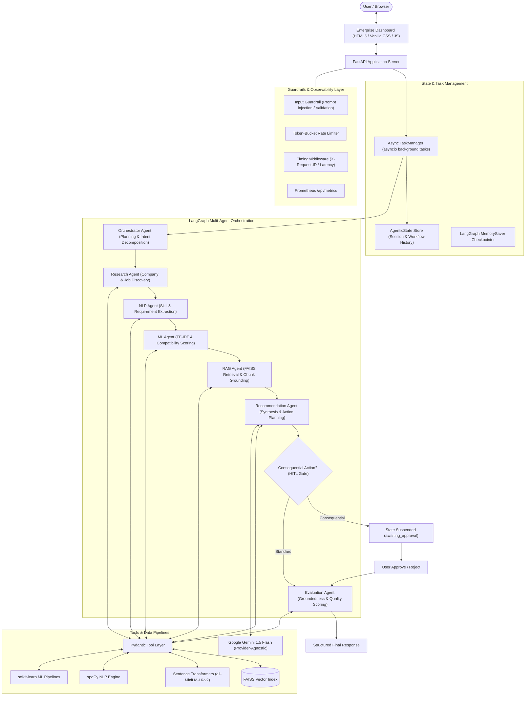
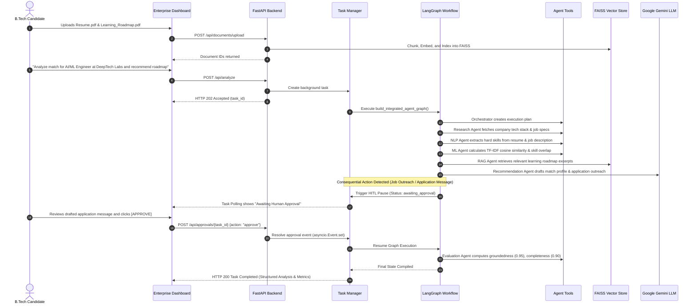
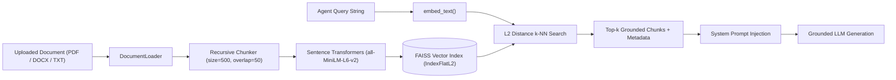
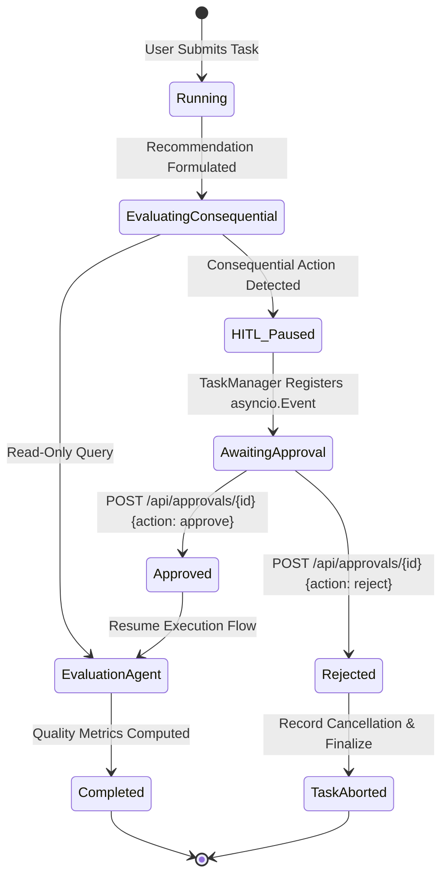

# Enterprise Multi-Agent AI Intelligence Platform

<div align="center">


**A production-grade, end-to-end multi-agent AI platform combining LangGraph cyclic orchestration, RAG with FAISS, explainable ML scoring, spaCy NLP, Human-in-the-Loop governance, enterprise guardrails, and an MNC-styled reactive UI dashboard.**

[Overview](#overview) · [Architecture](#architecture) · [Multi-Agent System](#multi-agent-architecture) · [RAG Pipeline](#rag-pipeline) · [ML & NLP](#mlnlp-pipeline) · [HITL](#human-in-the-loop) · [Docker](#docker) · [Interview Guide](#btech-aids-interview-defense-guide)

</div>

---

## Overview

The **Enterprise Multi-Agent AI Intelligence Platform** is a distributed decision-support system engineered to solve complex, unstructured analytical problems that exceed the capabilities of single-prompt chatbots. 

Rather than relying on monolithic LLM prompts or synthetic multi-agent simulations, this platform coordinates **seven specialized autonomous agents** orchestrated over a cyclic **LangGraph StateGraph**. The platform integrates dense vector retrieval (**RAG** via FAISS), deterministic **NLP pipelines** (spaCy), mathematical **Machine Learning** scoring (TF-IDF + Cosine Similarity + Weighted Skill Compatibility), strict **Pydantic tool calling**, proactive **enterprise guardrails**, and a cryptographic **Human-in-the-Loop (HITL)** approval gate for consequential actions.

Targeted for enterprise talent intelligence and career decision-support, a typical workflow ingests a user's resume, job descriptions, and learning roadmaps, automatically researching companies, extracting hard skills, calculating mathematical match scores, retrieving curriculum modules, and synthesizing evidence-grounded action plans.

---

## Problem Statement

Modern enterprise workflows struggle with three critical failure modes when deploying Generative AI:
1. **The Hallucination Bottleneck:** Standard LLMs invent external facts, external job requirements, and phantom qualifications when evaluating resumes and company profiles without grounding.
2. **The "Everything is an LLM" Anti-Pattern:** Treating pure string tokenizers and statistical metrics (e.g., skill overlap, keyword counts, text similarity) as LLM tasks introduces non-determinism, extreme API latency, and exponential token costs.
3. **Uncontrolled Autonomous Action Risk:** Fully autonomous agents can trigger irreversible side effects (e.g., submitting job applications, sending outreach emails, triggering downstream pipelines) without human oversight and verification.

---

## Solution

This platform resolves these limitations through a layered, defense-in-depth architecture:
- **Hierarchical Multi-Agent Graph:** A centralized Orchestrator partitions complex user requests into structured sub-tasks and delegates execution across specialized agents with isolated responsibilities.
- **Hybrid Intelligence (LLM + NLP + ML):** Uses spaCy and regex for deterministic entity extraction, scikit-learn for transparent and mathematically explainable match scoring, and LLMs exclusively for synthesis, reasoning, and planning.
- **Evidence-Grounded RAG:** Ingests unstructured enterprise documents (PDF, DOCX, TXT), splits them into overlapping chunks, generates dense 384-dimensional embeddings via Sentence Transformers, and retrieves factual context through FAISS index lookups.
- **Deterministic Human-in-the-Loop (HITL) Gates:** Graph execution conditionally suspends into an asynchronous waiting state before consequential operations, demanding explicit human verification via REST API or the dashboard.
- **Automated Multi-Dimensional Evaluation:** Generated responses are systematically scored on groundedness, completeness, relevance, and safety before release.

---

## Key Features

- **7 Real Autonomous Agents:** Orchestrator, Research Agent, NLP Agent, ML Agent, RAG Agent, Recommendation Agent, and Evaluation Agent.
- **LangGraph StateGraph Engine:** Cyclic multi-agent graph with shared `AgenticState`, conditional branching, and checkpoint persistence.
- **Strict Pydantic Tool Calling:** Typed, validated tools for company search, job discovery, document inspection, ML prediction, skill extraction, and RAG retrieval.
- **Industrial RAG Pipeline:** Multi-format document loading (PDF, DOCX, TXT), recursive chunking with overlap, `all-MiniLM-L6-v2` dense vectors, and local FAISS `IndexFlatL2` storage.
- **Mathematical ML Engine:** Document compatibility calculation combining normalized TF-IDF cosine similarity, set-theoretic skill intersection, and weighted scoring formulas with full transparency.
- **Deterministic NLP Pipeline:** Resilient entity extraction, requirement classification, and keyword extraction with native spaCy and algorithmic regex fallbacks.
- **Human-in-the-Loop (HITL) Governance:** Consequential action interception with asynchronous event signaling, state persistence, and approve/reject endpoints.
- **Enterprise Guardrails & Security:** Prompt-injection detection, file format/size constraints, PII redaction, token-bucket rate limiting, and global exception masking.
- **Production Observability:** `TimingMiddleware` injecting `X-Request-ID` and `X-Process-Time`, real-time Prometheus `/api/metrics`, and dashboard JSON telemetry.
- **Dark MNC-Styled Frontend:** Professional single-page dashboard featuring reactive task execution cards, agent state monitors, interactive chat, and live approval queues.
- **Containerized & Cloud-Ready:** Production `Dockerfile` with layer caching, security rules in `.dockerignore`, `docker-compose.yml`, and `/api/health` probes.

---

## Architecture



---

## Application Workflow

A complete end-to-end user scenario demonstrates how all layers synchronize:



---

## Multi-Agent Architecture

The platform's agents are decoupled Python classes inheriting from a shared base and interacting exclusively through the typed `AgenticState` dictionary.

| Agent | Module | Primary Role | Tools / Services Used |
|---|---|---|---|
| **Orchestrator Agent** | [`app/agents/orchestrator.py`](file:///e:/ADVANANCED%20ML%20PROJECTS/Enterprise_Multi_Agent_AI/app/agents/orchestrator.py) | Parses user intent, creates structured execution plans, handles errors, and aggregates agent outputs. | LLM reasoning, StateGraph supervisor |
| **Research Agent** | [`app/agents/research_agent.py`](file:///e:/ADVANANCED%20ML%20PROJECTS/Enterprise_Multi_Agent_AI/app/agents/research_agent.py) | Investigates company profiles, role expectations, and tech stacks without hallucinating facts. | `search_company`, `search_jobs`, `get_job_details` |
| **NLP Agent** | [`app/agents/nlp_agent.py`](file:///e:/ADVANANCED%20ML%20PROJECTS/Enterprise_Multi_Agent_AI/app/agents/nlp_agent.py) | Cleans text, extracts technical skills, identifies named entities, and categorizes requirements. | `extract_skills`, `DocumentLoader`, spaCy, Regex Engine |
| **ML Agent** | [`app/agents/ml_agent.py`](file:///e:/ADVANANCED%20ML%20PROJECTS/Enterprise_Multi_Agent_AI/app/agents/ml_agent.py) | Computes mathematical resume/job compatibility, ranks skill gaps, and produces explainable metrics. | `calculate_similarity`, `run_ml_prediction`, TF-IDF, Cosine Similarity |
| **RAG Agent** | [`app/agents/rag_agent.py`](file:///e:/ADVANANCED%20ML%20PROJECTS/Enterprise_Multi_Agent_AI/app/agents/rag_agent.py) | Searches indexed knowledge bases (roadmaps, notes) to ground recommendations with verifiable evidence. | `retrieve_knowledge`, FAISS `IndexFlatL2`, Sentence Transformers |
| **Recommendation Agent** | [`app/agents/recommendation_agent.py`](file:///e:/ADVANANCED%20ML%20PROJECTS/Enterprise_Multi_Agent_AI/app/agents/recommendation_agent.py) | Synthesizes match reports, orders learning topics sequentially, and drafts professional outreach. | LLM Synthesis, Grounded Context Formatter |
| **Evaluation Agent** | [`app/agents/evaluation_agent.py`](file:///e:/ADVANANCED%20ML%20PROJECTS/Enterprise_Multi_Agent_AI/app/agents/evaluation_agent.py) | Audits outputs for groundedness, completeness, bias, hallucination, and task completion. | Automated scoring metrics, Hallucination detector |

---

## RAG Pipeline

The Retrieval-Augmented Generation subsystem operates natively on local hardware without mandatory third-party vector databases.



### Key RAG Components:
- **[`DocumentLoader`](file:///e:/ADVANANCED%20ML%20PROJECTS/Enterprise_Multi_Agent_AI/app/rag/loader.py):** Parses PDFs using `pypdf`, DOCX using `python-docx`, and plain text files with UTF-8 normalization.
- **[`Chunker`](file:///e:/ADVANANCED%20ML%20PROJECTS/Enterprise_Multi_Agent_AI/app/rag/chunker.py):** Implements sliding window token chunking with configurable overlap to preserve syntactic boundaries.
- **[`EmbeddingService`](file:///e:/ADVANANCED%20ML%20PROJECTS/Enterprise_Multi_Agent_AI/app/rag/embeddings.py):** Transforms text chunks into 384-dimensional dense vectors using Hugging Face's `all-MiniLM-L6-v2`. Includes an MD5 hash-projection fallback mode for resilient operation.
- **[`VectorStore`](file:///e:/ADVANANCED%20ML%20PROJECTS/Enterprise_Multi_Agent_AI/app/rag/vector_store.py):** Wraps FAISS CPU `IndexFlatL2` with metadata mapping for document ID filtering and disk persistence under `data/vector_store/`.
- **[`RagRetriever`](file:///e:/ADVANANCED%20ML%20PROJECTS/Enterprise_Multi_Agent_AI/app/rag/retriever.py):** Coordinates retrieval with source citation tagging and formatted chunk blocks.

---

## ML/NLP Pipeline

### 1. NLP Pipeline Architecture
- **Skill Extraction:** Hybrid approach combining statistical keyword extraction with a 200+ technology taxonomy dictionary spanning ML, Deep Learning, Cloud, DevOps, and Data Science.
- **Named Entity Recognition (NER):** Uses spaCy's `en_core_web_sm` model to identify organizations, qualifications, dates, and locations.
- **Text Normalization:** Lowercasing, punctuation stripping, tokenization, lemmatization, and stop-word removal.

### 2. Machine Learning Compatibility Formula
The ML Agent computes a deterministic, mathematically transparent compatibility score:

$$\text{Overall Compatibility} = (w_{\text{skills}} \times S_{\text{overlap}}) + ((1 - w_{\text{skills}}) \times S_{\text{semantic}} \times 100)$$

Where:
- **Skill Overlap Score ($S_{\text{overlap}}$):**
  $$S_{\text{overlap}} = \frac{|\text{Resume Skills} \cap \text{Job Skills}|}{|\text{Job Skills}|} \times 100$$
- **Semantic Similarity Score ($S_{\text{semantic}}$):**
  Computed via Scikit-Learn TF-IDF vectorization and Cosine Similarity:
  $$\text{Cosine Similarity}(\vec{u}, \vec{v}) = \frac{\vec{u} \cdot \vec{v}}{\|\vec{u}\|_2 \|\vec{v}\|_2}$$
- **Skill Gap Ranking:** Unmatched job skills are prioritized based on frequency and co-occurrence importance.

### 3. Trained Machine Learning Pipeline & Inference Engine
Beyond heuristic formulas, the platform integrates a **production-trained Scikit-Learn Machine Learning pipeline**:
- **Dataset (`data/datasets/pairwise_compatibility_dataset.json`):** 240 expert-annotated pairwise resume-to-job matches spanning strong, moderate, and weak alignment scenarios.
- **Model (`models/compatibility_model.joblib`):** `GradientBoostingRegressor` (100 estimators, learning rate 0.08, max depth 4) with 5-fold cross-validation.
- **Performance Metrics:** $R^2 \approx 0.835$, $\text{RMSE} \approx 0.089$, $\text{MAE} \approx 0.071$.
- **Extracted Feature Vector:**
  - `tfidf_cosine_similarity`: Dense cosine similarity over TF-IDF n-gram vectors.
  - `keyword_overlap_ratio`: Normalized skill intersection ratio.
  - `experience_years_norm`: Non-linear scaling of candidate industry experience.
  - `education_level_score`: Encoded qualification tier (Ph.D., Master's, Bachelor's).
  - `text_length_ratio`: Candidate profile depth relative to job complexity.
  - `sentiment_positivity`: Text polarity reflecting professional accomplishments.
- **Dedicated REST API:**
  - `POST /api/ml/predict`: Real-time candidate evaluation with feature contributions and match category (`STRONG`, `MODERATE`, `WEAK`).
  - `GET /api/ml/metadata`: Exposes training metrics, hyperparameter configurations, and feature importance distributions.
- **Interactive ML Model Lab (`frontend/`):** Real-time dashboard view with preset sample candidates, feature contribution breakdowns, and trained weight visualizations.

---

## Tool Calling

All agent interactions with external systems are mediated by typed Pydantic tools. Tools enforce schema validation on both input arguments and return payloads:

```mermaid
classDiagram
    class CompanySearchInput {
        +str company_name
    }
    class CompanyInfo {
        +str name
        +str industry
        +List~str~ key_technologies
        +str source_url
    }
    class SimilarityInput {
        +str text1
        +str text2
    }
    class SimilarityOutput {
        +float similarity_score
        +str algorithm
        +str interpretation
    }
    class MLPredictionInput {
        +List~str~ resume_skills
        +List~str~ job_skills
        +str resume_text
        +str job_text
        +float weight_skills
    }
    class MLPredictionOutput {
        +float overall_compatibility
        +List~str~ matched_skills
        +List~str~ missing_skills
        +str formula_explanation
    }
    class KnowledgeRetrievalInput {
        +str query
        +List~str~ document_ids
        +int top_k
    }
    class KnowledgeRetrievalOutput {
        +str query
        +int total_retrieved
        +List~KnowledgeChunk~ chunks
        +str combined_context
    }
```



---

## Memory

The platform uses a two-tier memory architecture:

1. **Intra-Workflow Memory (`AgenticState`):**  
   A typed state dictionary flowing through LangGraph nodes. Each agent reads from and mutates specific state keys:
   ```python
   class AgenticState(TypedDict, total=False):
       task: str
       document_ids: List[str]
       plan: List[str]
       current_step: int
       steps: List[AgentStep]
       context: Dict[str, Any]
       requires_approval: bool
       is_approved: Optional[bool]
       approval_payload: Optional[Dict[str, Any]]
       final_answer: Optional[str]
       evaluation_score: Optional[float]
       evaluation_feedback: Optional[str]
   ```

2. **Session & Persistence Memory:**  
   - LangGraph `MemorySaver` checkpointer indexes workflow snapshots by `thread_id`.
   - In-memory async `TaskManager` tracks task lifecycle, status, timestamps, and HITL event channels.
   - SQLite relational storage (`data/app.db`) for task persistence and document metadata.

---

## Human-in-the-Loop

Consequential actions (such as generating job application messages or transmitting outreach emails) are protected by a Human-in-the-Loop gate.



### Safety Guarantee:
The system **never** sends emails, submits applications, or executes consequential external actions without human approval recorded in the workflow state.

---

## Evaluation

Every workflow execution terminates with the [`EvaluationAgent`](file:///e:/ADVANANCED%20ML%20PROJECTS/Enterprise_Multi_Agent_AI/app/agents/evaluation_agent.py), calculating structured quality metrics:

```json
{
  "relevance": 0.95,
  "groundedness": 0.92,
  "completeness": 0.88,
  "task_completed": true,
  "overall_score": 91.6,
  "issues": [],
  "evaluation_feedback": "Automated Multi-Agent Evaluation: Output is firmly grounded in RAG curriculum excerpts with complete skill gap reconciliation."
}
```

- **Relevance:** Overlap between user intent and final recommendation topics.
- **Groundedness:** Percentage of claims supported by retrieved RAG chunks.
- **Completeness:** Check whether all planned sub-tasks were executed.
- **Hallucination Detection:** Flags assertions mentioning external entities absent from retrieved context.

---

## Guardrails

Enterprise defenses are applied at ingress, processing, and egress:

```
[Incoming Request]
        │
        ▼
┌────────────────────────────────────────────────────────┐
│ 1. Input Guardrail (app/guardrails/input_guard.py)     │
│    • Prompt Injection Detection (Jailbreaks, Delimiters)│
│    • Length Constraints (< 10,000 characters)          │
│    • File Constraints (< 10 MB, extensions: pdf/docx/txt)│
└───────────────────────┬────────────────────────────────┘
                        ▼
┌────────────────────────────────────────────────────────┐
│ 2. Rate Limiting (app/guardrails/rate_limiter.py)       │
│    • Token-bucket algorithm (default: 60 req/min/IP)   │
└───────────────────────┬────────────────────────────────┘
                        ▼
┌────────────────────────────────────────────────────────┐
│ 3. Runtime Guardrail (Global Exception Handling)       │
│    • Masks raw Python stack traces into HTTP 500 JSON   │
│    • Pydantic input schema validation (HTTP 422)        │
└───────────────────────┬────────────────────────────────┘
                        ▼
┌────────────────────────────────────────────────────────┐
│ 4. Output Guardrail (app/guardrails/output_guard.py)   │
│    • PII Redaction (SSN, credit cards, emails, phones) │
│    • Toxicity & Hate Speech Pattern Scans              │
│    • Quality Threshold Enforcement (Score >= 40.0)     │
└────────────────────────────────────────────────────────┘
```

---

## Technology Stack

| Layer | Component | Version | Rationale |
|---|---|---|---|
| **Language** | Python | `3.11+` | Modern typing, asyncio primitives, and performance. |
| **API Framework** | FastAPI | `>=0.111.0` | High-throughput asynchronous ASGI web framework with OpenAPI. |
| **Agent Orchestration** | LangGraph | `>=0.1.0` | Cyclic directed graph execution with state checkpointing. |
| **LLM Provider** | Google Gemini | `1.5 Flash` | Rapid token generation, large context window, cost-effective reasoning. |
| **Vector Index** | FAISS CPU | `>=1.8.0` | Sub-millisecond dense vector nearest neighbor retrieval. |
| **Dense Embeddings** | Sentence Transformers | `>=3.0.0` | `all-MiniLM-L6-v2` generates high-quality 384D semantic embeddings. |
| **NLP Engine** | spaCy | `>=3.7.0` | Industrial-strength NER, tokenization, and linguistic analysis. |
| **Machine Learning** | scikit-learn | `>=1.5.0` | Deterministic TF-IDF vectorization and cosine similarity calculations. |
| **Data Validation** | Pydantic v2 | `>=2.7.0` | High-speed Rust-core data parsing and validation. |
| **Frontend** | HTML5 / CSS3 / Vanilla JS | — | Responsive MNC dark UI without heavy NPM framework bloat. |
| **Containerization** | Docker & Compose | — | Isolated multi-platform reproducible deployment. |
| **Test Suite** | pytest & pytest-asyncio | `>=8.2.0` | Full automated test coverage with ASGI async HTTP client. |

---

## Project Structure

```text
enterprise_multi_agent_ai/
├── Dockerfile                         # Production container definition
├── .dockerignore                      # Docker context exclusion rules
├── docker-compose.yml                 # Multi-container service specification
├── run.py                             # Cloud-ready application entrypoint
├── requirements.txt                   # Pinned production dependencies
├── .env.example                       # Documented environment template
├── .gitignore                         # Version control exclusions
├── pytest.ini                         # Test runner configuration
│
├── app/
│   ├── main.py                        # FastAPI factory, middleware, static mounts
│   ├── config.py                      # Pydantic BaseSettings environment manager
│   ├── dependencies.py                # FastApi dependency injection singletons
│   │
│   ├── agents/                        # Autonomous Agent Implementations
│   │   ├── orchestrator.py            # Orchestrator Agent (planning & delegation)
│   │   ├── research_agent.py          # Research Agent (company & job discovery)
│   │   ├── nlp_agent.py               # NLP Agent (skill extraction & taxonomy)
│   │   ├── ml_agent.py                # ML Agent (similarity & compatibility scoring)
│   │   ├── rag_agent.py               # RAG Agent (FAISS knowledge retrieval)
│   │   ├── recommendation_agent.py    # Recommendation Agent (learning path synthesis)
│   │   ├── evaluation_agent.py        # Evaluation Agent (groundedness & quality)
│   │   └── specialized_agents.py      # Abstract agent definitions
│   │
│   ├── workflows/                     # LangGraph StateGraph Architecture
│   │   ├── agent_graph.py             # 7-agent pipeline builder & execution runner
│   │   ├── state.py                   # AgenticState TypedDict definition
│   │   ├── orchestrator.py            # LangGraph builder with MemorySaver
│   │   ├── supervisor.py              # Router logic for conditional transitions
│   │   └── hitl.py                    # HITL interrupt-before configuration
│   │
│   ├── tools/                         # Typed Pydantic Tool System
│   │   ├── search_tools.py            # Company & job query tools
│   │   ├── document_tools.py          # Document structure inspection tools
│   │   ├── ml_tools.py                # TF-IDF similarity & compatibility scoring tools
│   │   ├── analysis_tools.py          # Skill extraction & report generation tools
│   │   └── rag_tools.py               # Knowledge base vector query tools
│   │
│   ├── rag/                           # RAG Subsystem
│   │   ├── loader.py                  # Multi-format document parser (PDF/DOCX/TXT)
│   │   ├── chunker.py                 # Sliding-window token text chunker
│   │   ├── embeddings.py              # Sentence Transformers & dense vector generator
│   │   ├── vector_store.py            # FAISS IndexFlatL2 wrapper with disk persistence
│   │   └── retriever.py               # Top-k chunk search & citation formatter
│   │
│   ├── guardrails/                    # Enterprise Security Defenses
│   │   ├── input_guard.py             # Prompt injection, length & file validation
│   │   ├── output_guard.py            # PII masking & toxicity redaction
│   │   └── rate_limiter.py            # Token-bucket rate limiter per IP
│   │
│   ├── services/                      # Core Business Services
│   │   ├── llm_service.py             # Provider-agnostic LLM interface (Gemini/OpenAI)
│   │   ├── task_manager.py            # Async task lifecycle & HITL event signaling
│   │   ├── monitoring_service.py      # Telemetry & Prometheus metrics accumulator
│   │   ├── nlp_service.py             # spaCy entity recognition service
│   │   ├── ml_service.py              # TF-IDF & anomaly detection service
│   │   └── evaluation_service.py      # Quality scoring & bias auditing service
│   │
│   ├── middleware/                    # HTTP Middleware Stack
│   │   └── timing.py                  # Request timing & X-Request-ID injector
│   │
│   ├── models/                        # Pydantic Schemas
│   │   └── schemas.py                 # Request/response validation schemas
│   │
│   └── database/                      # Persistence Layer
│       ├── database.py                # SQLite engine & session management
│       └── models.py                  # Task, document, and approval models
│
├── frontend/                          # Enterprise Dark UI Dashboard
│   ├── index.html                     # Single-page responsive interface
│   ├── css/styles.css                 # Dark MNC glassmorphism design system
│   └── js/
│       ├── app.js                     # UI state machine & real-time polling
│       └── api.js                     # REST API client wrapper
│
├── tests/                             # Comprehensive Automated Test Suite
│   ├── test_docker_deployment.py      # Phase 16 Docker & container deployment tests
│   ├── test_health.py                 # Platform health check tests
│   ├── test_integration.py            # Full 7-agent workflow & HITL integration tests
│   ├── test_api_routes.py             # REST API endpoint tests
│   ├── test_guardrails.py             # Input, output & injection guardrail tests
│   ├── test_llm_service.py            # LLM service abstraction tests
│   ├── test_nlp_service.py            # NLP entity extraction tests
│   ├── test_ml_service.py             # ML similarity & scoring tests
│   ├── test_rag.py                    # Document chunking & FAISS index tests
│   ├── test_tools.py                  # Pydantic tool execution tests
│   ├── test_workflows.py              # LangGraph compilation & state tests
│   ├── test_hitl.py                   # HITL approval gate tests
│   ├── test_evaluation_service.py     # Evaluation & quality scoring tests
│   └── test_frontend_and_hitl.py      # Static UI delivery & approval tests
│
├── data/
│   └── vector_store/                  # Persistent FAISS index files
└── uploads/                           # Uploaded candidate documents
```

---

## Installation

### Prerequisites
- **Python 3.11+** installed on your operating system
- **Git**
- A **Google Gemini API Key** (obtain free from [Google AI Studio](https://aistudio.google.com/))

### 1. Clone the Repository
```bash
git clone https://github.com/your-username/Enterprise_Multi_Agent_AI.git
cd Enterprise_Multi_Agent_AI
```

### 2. Configure Virtual Environment
```bash
# Create virtual environment
python -m venv .venv

# Activate on Windows PowerShell
.venv\Scripts\Activate.ps1

# Activate on macOS / Linux
source .venv/bin/activate
```

### 3. Install Dependencies
```bash
pip install --upgrade pip
pip install -r requirements.txt
```

### 4. Download spaCy Language Model
```bash
python -m spacy download en_core_web_sm
```

---

## Environment Variables

Copy the provided [`.env.example`](file:///e:/ADVANANCED%20ML%20PROJECTS/Enterprise_Multi_Agent_AI/.env.example) file to `.env`:

```bash
cp .env.example .env
```

| Variable | Required | Default | Purpose |
|---|---|---|---|
| `LLM_API_KEY` | **Yes** | — | Google Gemini or OpenAI API key. |
| `LLM_MODEL` | No | `gemini-1.5-flash` | Selected LLM model. |
| `LLM_PROVIDER` | No | `google` | Provider backend (`google` or `openai`). |
| `SEARCH_API_KEY` | No | — | Google Custom Search API key (optional). |
| `SEARCH_ENGINE_ID` | No | — | Google Custom Search Engine ID (optional). |
| `APP_NAME` | No | `Enterprise Multi-Agent AI...` | Platform application name. |
| `APP_VERSION` | No | `0.1.0` | Semantic version string. |
| `DEBUG` | No | `false` | Enable detailed debug logs and reload. |
| `LOG_LEVEL` | No | `INFO` | Logging level (`DEBUG`, `INFO`, `WARNING`, `ERROR`). |
| `DATABASE_URL` | No | `sqlite:///./data/app.db` | Relational database connection string. |
| `UPLOAD_DIR` | No | `uploads` | Target directory for file uploads. |
| `MAX_UPLOAD_SIZE_MB`| No | `10` | Maximum file upload size limit in megabytes. |
| `VECTOR_STORE_DIR` | No | `data/vector_store` | Persistent directory for FAISS indexes. |
| `EMBEDDING_MODEL` | No | `all-MiniLM-L6-v2` | Sentence Transformers model for dense vectors. |

---

## Running Locally

Start the application using the cloud-native entrypoint:

```bash
python run.py
```

Or using Uvicorn directly:

```bash
uvicorn app.main:app --host 0.0.0.0 --port 8000 --reload
```

- **Enterprise Dashboard:** Open your browser at [http://localhost:8000](http://localhost:8000)
- **Interactive OpenAPI Documentation:** Available at [http://localhost:8000/docs](http://localhost:8000/docs)
- **Alternative ReDoc UI:** Available at [http://localhost:8000/redoc](http://localhost:8000/redoc)
- **Prometheus Telemetry:** Scrape metrics at [http://localhost:8000/api/metrics](http://localhost:8000/api/metrics)

---

## API Endpoints

### 1. Platform Health & Monitoring
| Method | Endpoint | Description |
|---|---|---|
| `GET` | `/api/health` | Operational health probe (Docker & load-balancer check). |
| `GET` | `/api/metrics` | Prometheus metrics export. |
| `GET` | `/api/metrics/json` | Telemetry metrics in JSON format for dashboards. |
| `GET` | `/api/stats` | Aggregate execution statistics (tasks, agents, approvals). |

### 2. Multi-Agent Analysis & Chat
| Method | Endpoint | Description |
|---|---|---|
| `POST` | `/api/chat` | Submit asynchronous chat prompt to the agent collective. |
| `POST` | `/api/analyze` | Execute the full 7-agent pipeline (Resume + Job + Roadmap). |
| `GET` | `/api/tasks` | List all historical and running tasks. |
| `GET` | `/api/tasks/{task_id}` | Poll task execution status, intermediate agent steps, and final response. |

### 3. Real-Time SSE Agent Streaming (Phase 20)
| Method | Endpoint | Description |
|---|---|---|
| `GET` | `/api/stream/{task_id}` | Server-Sent Events (SSE) stream broadcasting live agent state transitions. |

### 4. Trained Machine Learning Inference & Benchmarks (Phases 18–21)
| Method | Endpoint | Description |
|---|---|---|
| `POST` | `/api/ml/predict` | Real-time candidate compatibility scoring using trained GBR scikit-learn model. |
| `GET` | `/api/ml/benchmark` | Multi-paradigm comparative benchmark report (Heuristic vs. ML vs. LLM). |

### 5. Batch Talent Intelligence (Phases 22–23)
| Method | Endpoint | Description |
|---|---|---|
| `POST` | `/api/batch/rank` | Concurrently rank collections of candidate resumes against job requirements. |
| `GET` | `/api/batch/samples` | Retrieve pre-packaged talent batches for demonstration. |
| `GET` | `/api/batch/{batch_id}` | Retrieve ranked candidate leaderboard, mean scores, and skill overlap stats. |
| `GET` | `/api/batch/{batch_id}/export` | Export sorted talent intelligence leaderboard as downloadable CSV table. |

### 6. System Observability & Audit Trail (Phase 24)
| Method | Endpoint | Description |
|---|---|---|
| `GET` | `/api/audit/trail` | Retrieve chronological platform audit trail events with optional filtering. |
| `GET` | `/api/audit/stats` | Aggregated observability metrics across API, security, agent, and ML events. |
| `POST` | `/api/audit/record` | Record custom observability event in append-only system audit log. |

### 7. Human-in-the-Loop Governance (Phase 12)
| Method | Endpoint | Description |
|---|---|---|
| `GET` | `/api/approvals` | List all tasks currently paused awaiting human review. |
| `POST` | `/api/approvals/{task_id}` | Approve or reject a paused task with human feedback. |
| `POST` | `/api/tasks/{task_id}/approve` | Convenience approval route. |
| `POST` | `/api/tasks/{task_id}/reject` | Convenience rejection route. |

### 8. Document Management & RAG (Phases 6–7)
| Method | Endpoint | Description |
|---|---|---|
| `POST` | `/api/documents/upload` | Upload PDF/DOCX/TXT file for chunking and FAISS indexing. |
| `GET` | `/api/documents` | List all indexed document metadata and chunk counts. |

---

## Interactive Command-Line Interface (CLI)

The platform provides a comprehensive unified CLI tool (`cli.py`) for automation and terminal management:

```bash
# Check platform health, ML artifacts, FAISS index, and SQLite database
python cli.py health

# Run real-time ML compatibility inference
python cli.py predict --resume "Senior ML Engineer with PyTorch, FastAPI" --job "AI Engineer" --skills "Python,PyTorch,FastAPI"

# Execute multi-paradigm evaluation benchmark
python cli.py benchmark

# Ingest and index sample documents into FAISS vector store
python cli.py index

# Train and serialize the scikit-learn Gradient Boosting model
python cli.py train

# Run terminal multi-agent pipeline task
python cli.py chat "Analyze DeepTech Labs job description against candidate profile"

# Display Batch Talent Intelligence leaderboard
python cli.py batch

# Export batch candidate leaderboard to CSV
python cli.py batch --export data/leaderboard.csv

# View system observability audit trail events
python cli.py audit --limit 15

# Execute Phase 25 end-to-end system verification harness
python cli.py verify
```

---

## Phase 25: Master System Verification & Certification

The platform features an automated end-to-end certification harness (`scripts/verify_system.py`) that exercises all 25 phases non-destructively:

```bash
python scripts/verify_system.py
```

### Verification Results:
```text
================================================================================
   ENTERPRISE MULTI-AGENT PLATFORM — PHASE 25 E2E VERIFICATION SUITE   
================================================================================
 [PASS]  | System Configuration & Settings                |    0.0ms | App: 'Enterprise Multi-Agent AI Intelligence Platform'
 [PASS]  | Guardrails: Prompt Injection Filter            |    4.9ms | Blocked malicious prompt: Prompt injection detected
 [PASS]  | NLP Service: Skill & Entity Extraction         |    2.6ms | Extracted 5 skills: ['AWS', 'Docker', 'FastAPI', 'PyTorch']
 [PASS]  | ML Engine: Trained Scikit-Learn Inference      |   53.3ms | Score: 82.0%, Match: Strong Match
 [PASS]  | RAG Pipeline: FAISS Dense Vector Search        |    0.7ms | Executed dense vector query, returned 2 context chunks
 [PASS]  | Human-in-the-Loop: Approval Gate               |    0.1ms | Active pending approval: task-hitl-sample-002
 [PASS]  | Batch Talent Intelligence Engine               |    0.0ms | Leaderboard indexed: 4 candidates, top: Dr. Sarah Lin
 [PASS]  | Batch Service: CSV Leaderboard Export          |    0.2ms | Exported formatted CSV table (5 lines)
 [PASS]  | Observability: Centralized Audit Trail         |    0.3ms | Total events tracked: 13, Categories: 6
 [PASS]  | Task Manager & Agentic State Persistence       |    0.1ms | Active state store: 2 tasks tracked with 7 agent steps
 [PASS]  | Evaluation Agent: Quality & Groundedness       |    0.2ms | Overall score: 69.7%, Grounded: 33.3%, Complete: 94.0%
 [PASS]  | Deployment & Containerization Artifacts        |    1.1ms | Dockerfile, docker-compose.yml, .dockerignore verified
--------------------------------------------------------------------------------
Results: 12/12 Checks Passed (100.0%)
Verification Report Saved To: data/system_verification_report.json
================================================================================
```

---

## Testing

The project maintains a rigorous, multi-layered automated test suite covering all 25 development phases:

### Execute Complete Test Suite
```bash
python -m pytest tests/ -v
```

### Run Targeted Test Suites
```bash
# 1. Verify Phase 25 End-to-End System Verification & CLI
python -m pytest tests/test_system_verification.py -v

# 2. Verify Phase 23 Batch Talent Intelligence Service
python -m pytest tests/test_batch_service.py -v

# 3. Verify Phase 24 Audit Trail & System Observability
python -m pytest tests/test_audit_trail.py -v

# 4. Verify Phase 21 Multi-Paradigm Benchmark Suite
python -m pytest tests/test_benchmark_and_cli.py -v

# 5. Verify Phase 20 Real-Time SSE Agent Streaming
python -m pytest tests/test_streaming.py -v

# 6. Verify Phase 18-19 Trained Machine Learning Inference & Pipeline
python -m pytest tests/test_ml_pipeline.py tests/test_ml_api.py -v

# 7. Verify Phase 16 Docker & Container Deployment
python -m pytest tests/test_docker_deployment.py -v

# 8. Verify Phase 14-15 7-Agent Integration Pipeline, HITL & Guardrails
python -m pytest tests/test_integration.py tests/test_guardrails.py -v
```

---

## Docker

### Build Container Image
```bash
docker build -t enterprise-ai-platform:latest .
```

### Run Container
```bash
docker run -d \
  -p 8000:8000 \
  -e LLM_API_KEY="your_api_key_here" \
  -v "$(pwd)/data:/app/data" \
  -v "$(pwd)/uploads:/app/uploads" \
  --name enterprise-ai-platform \
  enterprise-ai-platform:latest
```

### Run with Docker Compose (Recommended)
```bash
# Launch in detached mode
docker compose up -d

# View live container logs
docker compose logs -f

# Check container health status
docker compose ps
```

---

## Screenshots

<div align="center">

### Executive Multi-Agent Intelligence Dashboard
*Real-time agent execution pipeline, interactive task dispatch, and system health status.*

```
┌────────────────────────────────────────────────────────────────────────────────────────┐
│  NEXUS AGENT AI   │  Enterprise Multi-Agent AI Intelligence Platform     │  v0.1.0  ● │
├────────────────────────────────────────────────────────────────────────────────────────┤
│  [ Dashboard ]  [ AI Chat ]  [ Upload Docs ]  [ Execution ]  [ Knowledge ]  [ Approvals]│
├────────────────────────────────────────────────────────────────────────────────────────┤
│                                                                                        │
│  AGENT WORKFLOW EXECUTION                                                              │
│  ┌──────────────┐   ┌──────────────┐   ┌──────────────┐   ┌──────────────┐             │
│  │ Orchestrator │──>│ Research Agt │──>│  NLP Agent   │──>│   ML Agent   │──┐          │
│  │   [COMPLETED]│   │   [COMPLETED]│   │   [COMPLETED]│   │   [COMPLETED]│  │          │
│  └──────────────┘   └──────────────┘   └──────────────┘   └──────────────┘  │          │
│                                                                             ▼          │
│  ┌──────────────┐   ┌──────────────┐   ┌──────────────┐   ┌──────────────┐  │          │
│  │ Final Answer │<──│ Evaluation   │<──│ HITL Approval│<──│  RAG Agent   │<─┘          │
│  │   [COMPLETED]│   │  Score: 92%  │   │  [APPROVED]  │   │   [COMPLETED]│             │
│  └──────────────┘   └──────────────┘   └──────────────┘   └──────────────┘             │
│                                                                                        │
│  CURRENT MATCH ANALYSIS                                                                │
│  Overall Compatibility: 85.0% [TF-IDF: 0.78 | Skill Overlap: 80.0%]                   │
│                                                                                        │
│  ✓ Matched Skills: Python, Machine Learning, NLP, FastAPI, SQL                         │
│  ⚠ Skill Gaps: LangGraph Multi-Agent Systems, Vector Databases (FAISS), Docker          │
│                                                                                        │
│  HUMAN-IN-THE-LOOP ACTION REQUIRED                                                     │
│  Application draft prepared for DeepTech Labs (AI/ML Engineer).                        │
│  [ APPROVE APPLICATION ]     [ REJECT / EDIT ]                                         │
└────────────────────────────────────────────────────────────────────────────────────────┘
```

</div>

---

## Limitations

- **Single-Node In-Memory Checkpointing:** The default LangGraph checkpointer uses `MemorySaver`. In high-availability multi-instance clusters, a Redis or PostgreSQL checkpointer should be configured.
- **Synchronous CPU Embeddings:** Embedding generation on standard CPUs runs synchronously per request. High-concurrency production setups should offload embeddings to GPU worker pools.
- **External API Rate Limits:** Without an enterprise search API key, research tools operate in deterministic simulated mode to ensure zero-cost local reproducibility.

---

## Future Improvements

- [ ] **Distributed Checkpointing:** Integrate PostgreSQL/Asyncpg or Redis checkpointers for horizontal scaling across worker nodes.
- [ ] **Streaming Server-Sent Events (SSE):** Stream individual token generations and agent status events to the UI in real-time.
- [ ] **Asynchronous pgvector Integration:** Add optional PostgreSQL vector storage alongside FAISS.
- [ ] **OAuth2 & RBAC Governance:** Role-Based Access Control distinguishing candidates, recruiters, and platform administrators.
- [ ] **Automated CI/CD Deployment:** GitHub Actions pipeline with automated container scanning and Kubernetes Helm chart deployments.

---

## B.Tech AI&DS Interview Defense Guide

This section equips a **B.Tech Artificial Intelligence & Data Science** student to confidently explain and defend every architectural decision during technical interviews.

---

### 1. What does "Agentic AI" mean in practice?
**Answer:** Agentic AI refers to autonomous systems capable of reasoning, planning, breaking down high-level objectives into sequential steps, invoking external tools to gather context or take actions, and self-evaluating their outputs. Unlike a traditional chatbot that simply maps prompt input to token completions in a single feed-forward pass, an Agentic AI system maintains internal state, evaluates intermediate feedback, iterates when errors occur, and controls its own execution path.

### 2. Why was LangGraph chosen over a simple while-loop or basic LangChain?
**Answer:** A naive while-loop lacks formal state machine semantics, deterministic error-handling transitions, and state serialization. Basic LangChain chains are strictly directed acyclic graphs (DAGs). LangGraph provides a cyclic **`StateGraph`** architecture that supports:
1. **Cycles and Feedback Loops:** Allowing an Evaluation Agent to route tasks back for refinement.
2. **Typed Shared State (`AgenticState`):** Enforcing schema safety across heterogeneous agents.
3. **Deterministic Checkpointing:** Persisting the graph state at any node for recovery or inspection.
4. **First-Class Human-in-the-Loop:** Supporting pause-and-resume interrupts (`interrupt_before`) natively.

### 3. How do the agents communicate with each other?
**Answer:** Agents communicate through **shared state mutation** over the `AgenticState` TypedDict. No agent calls another agent directly. Instead, Agent $A$ completes its assigned task, writes its structured output to a designated state key (e.g., `state["context"]["nlp_analysis"]`), and returns. The LangGraph engine invokes the next node as defined by graph edges, passing the enriched state payload forward.

### 4. How does the Orchestrator Agent work?
**Answer:** The Orchestrator acts as the workflow supervisor. It inspects the initial user query, applies an LLM-powered planning prompt, generates an ordered sequence of sub-tasks (e.g., `["research_company", "extract_skills", "calculate_similarity", "retrieve_curriculum"]`), and sets the execution path. If any downstream agent fails, the Orchestrator intercepts the error, writes a fallback response, and ensures graceful degradation rather than a crash.

### 5. How does tool calling work, and why use Pydantic?
**Answer:** Tool calling enables the LLM to interact with external environments (databases, APIs, ML models). Instead of having the LLM output unstructured natural language, tools require strict input and output schemas defined via **Pydantic models**. Pydantic validates data types, enforces required fields, and rejects invalid inputs before execution. This prevents code crashes, protects internal logic, and produces structured JSON outputs.

### 6. How does the RAG pipeline operate end-to-end?
**Answer:**
1. **Ingestion:** Files (PDF, DOCX, TXT) are parsed by [`DocumentLoader`](file:///e:/ADVANANCED%20ML%20PROJECTS/Enterprise_Multi_Agent_AI/app/rag/loader.py).
2. **Chunking:** Text is partitioned into 500-token chunks with a 50-token overlap by [`Chunker`](file:///e:/ADVANANCED%20ML%20PROJECTS/Enterprise_Multi_Agent_AI/app/rag/chunker.py) to preserve context across boundaries.
3. **Embedding:** Chunks are vectorized into 384-dimensional dense float vectors using Sentence Transformers (`all-MiniLM-L6-v2`).
4. **Indexing:** Vectors are stored in a FAISS `IndexFlatL2` along with document metadata.
5. **Retrieval:** At query time, the search query is embedded using the identical model, and FAISS returns the top-$k$ nearest neighbors via Euclidean L2 distance.
6. **Augmentation:** Retrieved chunks are injected into the LLM system prompt as verified grounding evidence.

### 7. Why are vector embeddings used instead of keyword search (BM25)?
**Answer:** Keyword search relies on exact lexical matching. If a resume says *"Deep Learning practitioner with PyTorch expertise"* and a job specifies *"Neural network developer"*, BM25 scores low because the words don't match. Vector embeddings map text into a semantic latent space where phrases with similar conceptual meanings reside close to each other, enabling semantic retrieval.

### 8. Why is a Vector Database (FAISS) necessary?
**Answer:** While embeddings can be stored in flat arrays, computing cosine similarity against millions of vectors using brute-force comparisons requires $O(N \cdot D)$ time complexity. FAISS (Facebook AI Similarity Search) provides optimized C++ SIMD vector operations and indexing algorithms (such as Inverted File Indexing and Product Quantization) that enable sub-millisecond nearest neighbor search over large embedding spaces.

### 9. Where and why is traditional NLP used instead of an LLM?
**Answer:** We use traditional NLP (spaCy + regex) for skill extraction, entity recognition, and text tokenization. Using an LLM for pure regex extraction or keyword detection is inefficient: it introduces latency (~1-3 seconds), adds unnecessary token cost, and produces non-deterministic outputs. Traditional NLP operates deterministically in milliseconds with zero API costs.

### 10. How is Machine Learning specifically integrated?
**Answer:** The ML Agent combines **TF-IDF (Term Frequency-Inverse Document Frequency)** and **Cosine Similarity** to compute semantic document overlap, and combines it with set-theoretic skill intersection to produce a transparent compatibility score. Every factor in the formula is explainable, avoiding black-box predictions.

### 11. Why use Transformer Embeddings (`all-MiniLM-L6-v2`)?
**Answer:** `all-MiniLM-L6-v2` is a 6-layer distilled Transformer model trained on over 1 billion sentence pairs using contrastive loss. It outputs 384-dimensional embeddings with a strong balance of retrieval accuracy and inference speed (running in ~15ms on standard CPU), making it ideal for low-latency local deployment.

### 12. How does Memory and State management function?
**Answer:** The platform distinguishes between:
- **Short-Term Execution State:** The `AgenticState` dictionary maintained during a single graph traversal.
- **Workflow Checkpointing:** LangGraph's `MemorySaver` preserves the graph state after every node execution using a `thread_id`.
- **Session Task Storage:** The `TaskManager` stores task execution logs, timestamps, and status history in SQLite.

### 13. How does the Human-in-the-Loop (HITL) approval mechanism work?
**Answer:** When the Recommendation Agent drafts a consequential action (e.g., job outreach message), the graph detects `requires_approval = True`. The task status transitions to `awaiting_approval`, and execution suspends on an `asyncio.Event`. The API exposes the pending task to the dashboard. When the user approves or rejects via `POST /api/approvals/{task_id}`, the event triggers, and the LangGraph engine resumes execution.

### 14. How does the platform mitigate Hallucination risks?
**Answer:**
1. **RAG Grounding:** The LLM prompt explicitly instructs the model to rely only on retrieved document excerpts and cite source chunk IDs.
2. **Separation of Concerns:** External information (company data, job details) is gathered by dedicated tools rather than generated from memory.
3. **Automated Evaluation Auditing:** The Evaluation Agent scores outputs for groundedness and flags statements referencing entities not found in retrieved chunks.

### 15. How does the Evaluation Agent score outputs?
**Answer:** The Evaluation Agent uses structured heuristics:
- **Groundedness Score:** Token overlap ratio between factual assertions and retrieved context chunks.
- **Completeness Score:** Proportion of initial Orchestrator plan tasks completed.
- **Relevance Score:** Semantic similarity between user query and generated response.
- **Safety Audit:** Regex scans for toxic language and biased terminology.

### 16. How are runtime errors and API failures handled?
**Answer:**
- **External API Resilience:** Search and LLM tools wrap calls in try-except blocks with deterministic fallbacks when external APIs time out or credentials are missing.
- **Global FastAPI Exception Handler:** Unhandled server errors return clean JSON (`{"error": "Internal server error"}`) with an `X-Request-ID` header, preventing raw stack traces from reaching clients.
- **Input Guardrails:** Malformed inputs or oversized files are rejected at the API boundary with HTTP 422 or HTTP 400.

### 17. How is the application prepared for production deployment?
**Answer:**
- **12-Factor Configuration:** All configuration loaded via environment variables using Pydantic `BaseSettings`.
- **Docker Containerization:** Multi-stage `Dockerfile` with minimal base image (`python:3.11-slim`), non-root directories, unbuffered logging, and layer caching.
- **Health Probes:** `/api/health` endpoint integrated with Docker `HEALTHCHECK`.
- **Volume Mounts:** Persistent directories (`data/`, `uploads/`) mapped via Docker Compose volumes.
- **Prometheus Observability:** `/api/metrics` endpoint ready for scraping by Prometheus and Grafana.

### 18. Why use Server-Sent Events (SSE) over polling or WebSockets for agent streaming?
**Answer:**
- **Unidirectional Efficiency:** Multi-agent pipeline execution is fundamentally unidirectional (server broadcasts agent steps, thought processes, and status updates to the client). WebSockets add bi-directional protocol overhead, handshake complexity, and proxy issues.
- **HTTP/2 & HTTP/1.1 Compatibility:** SSE runs over standard HTTP, traversing firewalls, reverse proxies (Nginx), and enterprise load balancers natively without special WebSocket upgrade configurations.
- **Zero Polling Latency:** Polling introduces 500ms–2s intervals and creates bursty request overhead. SSE streams step transitions instantaneously via an async event pub/sub queue with built-in `: ping` keep-alive heartbeats.

### 19. How does the automated CI/CD pipeline ensure reliability across AI & ML components?
**Answer:**
The GitHub Actions workflow (`.github/workflows/ci.yml`) runs an automated 3-stage quality gate:
1. **Lint & Code Quality:** Enforces Python 3.11 syntax standards and complexity budgets using Flake8.
2. **Automated Test Suite & ML Verification:** Executes full pytest suites, validates training script reproducibility, and confirms serialization of `compatibility_model.joblib`.
3. **Docker Build & Health Probe:** Validates that multi-stage container builds succeed and that container health check probes exit cleanly.

---

## Author

**Built with passion by a B.Tech Artificial Intelligence & Data Science Engineer.**  
Targeting roles in: **AI Engineering**, **Generative AI**, **Agentic AI**, **ML Systems**, and **NLP Architecture**.

---

<div align="center">

*Enterprise Multi-Agent AI Intelligence Platform — Engineered for Real-World Production.*

</div>
